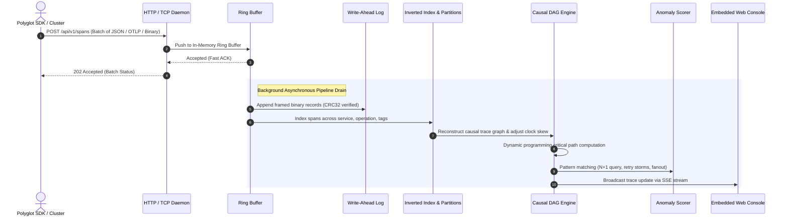

# Vernier System Architecture

Vernier is a high-performance distributed tracing and performance telemetry engine designed in Racket, supplemented with polyglot client SDKs in Python and C99. It addresses a fundamental problem in distributed systems observability: standard APM tools record spans as isolated intervals without understanding the causal structure or computing which specific sub-operations bounded end-to-end request latency.

Vernier ingests structured spans, reconstructs causal Directed Acyclic Graphs (DAGs) across multi-tier service boundaries, calculates the mathematical critical path of distributed transactions, detects subtle structural anomalies (such as N+1 query loops and retry storms), and serves real-time flamegraphs and service topologies through an embedded zero-dependency web console.

```
                          +-------------------------------------------------+
                          |             Vernier Ingestion Layer             |
                          | (W3C TraceContext / OTLP JSON / Compact Binary) |
                          +-------------------------------------------------+
                                                   |
                                                   v
                          +-------------------------------------------------+
                          |              High-Throughput Ring Buffer        |
                          |            (Lock-Free Fixed-Capacity FIFO)      |
                          +-------------------------------------------------+
                                    |                              |
                                    v                              v
                    +------------------------------+   +------------------------------+
                    |    Write-Ahead Log (WAL)     |   |    Multi-Dimensional Index   |
                    | (CRC32 Segmented Persistence)|   | (Posting Lists & Time Slices)|
                    +------------------------------+   +------------------------------+
                                                                   |
                                                                   v
                                                   +----------------------------------+
                                                   |     Causal DAG Engine & Graph    |
                                                   |  (Tarjan SCC / Clock Skew Hull)  |
                                                   +----------------------------------+
                                                                   |
                                                                   v
                                                   +----------------------------------+
                                                   |   Critical Path Analysis (DP)    |
                                                   |   (Longest Path over Span Nodes) |
                                                   +----------------------------------+
                                                                   |
                                    +------------------------------+------------------------------+
                                    |                              |                              |
                                    v                              v                              v
                    +------------------------------+   +------------------------------+   +------------------------------+
                    |   Anomaly Detection Engine   |   |    VQL Query Processing      |   |   Real-Time Telemetry Hub    |
                    | (Welford Z-Score / Patterns) |   | (Lexer / Recursive Parser)   |   | (Embedded Console & SSE)     |
                    +------------------------------+   +------------------------------+   +------------------------------+
```

---

## 1. Core Architectural Pillars

1. **Causal Graph Reconstruction over Flat Spans**: Rather than treating spans as loose timestamp logs, Vernier models each trace as a directed causal execution graph $G = (V, E)$, verifying acyclicity via Kahn's algorithm and identifying distributed feedback loops via Tarjan's Strongly Connected Components algorithm.
2. **Deterministic Critical Path Decomposition**: Parallel service calls frequently mask total latency. Vernier computes the topological critical path using dynamic programming, pinpointing the exact sequence of dependencies that bounded total transaction duration.
3. **Probabilistic Telemetry Streaming**: Bounded-memory streaming sketches (DDSketch with relative error $\alpha = 0.01$, HyperLogLog with Murmur64 mixing, Kirsch-Mitzenmacher double-hashing Bloom filters, and exponentially decaying reservoirs) provide sub-millisecond quantile and cardinality queries without unbounded allocation.
4. **Crash-Resilient Zero-GC Storage**: Ingestion separates fast memory buffering from durable persistence. A fixed-capacity ring buffer feeds both an inverted multi-attribute index and an append-only Write-Ahead Log (WAL) with 32-bit CRC checksum framing.
5. **Zero-Dependency Embedded Web Console**: Vernier embeds an interactive SVG flamegraph generator, dynamic waterfall renderer, and live Server-Sent Events (SSE) telemetry feed directly into the Racket runtime without external node modules, webpack bundles, or cloud agents.

---

## 2. Ingestion and Causal Reconstruction Pipeline

When a microservice cluster executes a transaction, spans flow into Vernier via one of three protocols:
- **W3C TraceContext over HTTP**: Standard `traceparent` and `tracestate` header propagation.
- **OpenTelemetry (OTLP) JSON**: Ingestion endpoint compatible with OTLP v1 protobuf JSON serializers.
- **Compact Binary Wire Protocol**: Fixed-header 56-byte binary framing for ultra-low latency internal transport.



---

## 3. Storage Subsystem and Memory Layout

### 3.1 Lock-Free Ring Buffer
Ingested spans are first enqueued into a pre-allocated circular ring buffer. A dedicated flush routine pulls batches in chunks of up to 4,096 elements to saturate downstream columnar compressors and inverted index postings without lock contention.

### 3.2 Write-Ahead Log (WAL) Binary Framing
Each WAL record is persisted to disk using a framed binary structure:

```
+-------------------+-------------------+-------------------+-------------------+
|  Magic (2 Bytes)  |  Version (1 Byte) | Record Type (1 B) | Length (4 Bytes)  |
|      0x56 0x57    |       0x01        |    SPAN = 0x01    |   Big-Endian uint |
+-------------------+-------------------+-------------------+-------------------+
|  CRC-32 (4 Bytes) |                   Payload Data (N Bytes)                  |
|    IEEE 802.3     |                  Raw Canonical JSON Bytes                 |
+-------------------+-------------------+-------------------+-------------------+
```

- **Magic Header (`0x56 0x57`)**: ASCII characters 'V' and 'W' (Vernier WAL).
- **CRC-32**: Calculated over the length and payload bytes. Corrupted frames caused by partial writes or disk tears are detected and cleanly skipped during recovery.
- **Segment Rolling**: Active segments roll automatically when reaching the configured threshold (default 64MB).

### 3.3 Multi-Dimensional Inverted Index
To support high-speed queries without scanning full trace payloads, Vernier maintains inverted posting lists:
- `service_postings`: Mapping from service name string to a set of matching Trace IDs.
- `operation_postings`: Mapping from operation name to Trace IDs.
- `status_postings`: Fast lookup sets for `'ok` and `'error` statuses.
- `tag_postings`: Attribute key-value pairs indexed via hash table lookups.

When executing multi-attribute queries, Vernier takes the intersection of candidate posting sets before loading trace records, guaranteeing $O(\min(|S_i|))$ retrieval complexity.

---

## 4. Graph Construction and Clock Skew Compensation

Distributed clocks across physical servers drift inevitably. Without adjustment, child spans can appear to start before their parents, producing negative latencies or causal cycles.

### Convex Hull Clock Skew Compensation
Vernier models parent-child intervals as causal bounding constraints:
1. For every parent span $P$ and child span $C$ where $C$ represents an RPC executed within $P$:
   $$C.\text{start} \ge P.\text{start} + \delta_{\text{network}}$$
   $$C.\text{end} \le P.\text{end} - \delta_{\text{network}}$$
2. When clock skew causes $C.\text{start} < P.\text{start}$, Vernier computes the skew offset $\Delta$:
   $$\Delta = P.\text{start} + \epsilon - C.\text{start}$$
3. An affine transformation shifts child timestamp coordinates while preserving relative internal durations across the child's entire sub-tree:
   $$\forall s \in \text{Subtree}(C): s.\text{start} \leftarrow s.\text{start} + \Delta, \quad s.\text{end} \leftarrow s.\text{end} + \Delta$$

---

## 5. Algorithmic Critical Path Decomposition

In a synchronous sequential execution, the critical path trivially equals the total trace duration. However, in modern distributed architectures with parallel fanouts, asynchronous dispatch, and concurrent database queries, total trace duration is governed by a subset of spans.

Vernier implements critical path calculation via topological dynamic programming:
1. **DAG Topological Linearization**: The causal graph is sorted topologically using Kahn's algorithm:
   $$v_1, v_2, \dots, v_n \quad \text{such that} \quad (v_i \to v_j) \implies i < j$$
2. **Earliest Start and Longest Path Dynamic Program**:
   Let $D(v)$ be the duration of span $v$.
   The longest path to node $v$, denoted $L(v)$, satisfies the recurrence:
   $$L(v) = D(v) + \max_{u \in \text{Parents}(v)} L(u)$$
3. **Critical Span Backtracking**: Starting from the node with $\max_{v \in \text{Leaves}} L(v)$, Vernier backtracks through maximal predecessor edges to reconstruct the critical path $P_{\text{crit}}$.
4. **Service Attribution**: Each service's critical contribution is computed by summing the durations of critical spans belonging to that service:
   $$\text{Attribution}(S) = \frac{\sum_{v \in P_{\text{crit}}, \text{Service}(v) = S} D(v)}{\text{Duration}(P_{\text{crit}})} \times 100\%$$

---

## 6. Anomaly Detection and Pattern Matching

Vernier runs real-time statistical and structural evaluators over every completed trace:
- **Welford Z-Score Anomaly Detector**: Maintains streaming running mean $\mu$ and sample variance $M_2$ per service operation:
  $$\mu_k = \mu_{k-1} + \frac{x_k - \mu_{k-1}}{k}, \quad M_{2,k} = M_{2,k-1} + (x_k - \mu_{k-1})(x_k - \mu_k)$$
  Spans exceeding a configurable Z-score threshold (default $Z \ge 3.0$) are flagged as latency anomalies.
- **N+1 Query Pattern Detection**: Scans for sequences where a parent span executes $\ge N$ (default 10) sequential child queries against the same database target with near-identical signatures.
- **Retry Storm Detection**: Flags cascades where a downstream service fails repeatedly with status `'error` and identical operation signatures under short exponential backoff intervals.
- **Fanout Explosion**: Identifies parent spans dispatching $> 30$ concurrent asynchronous child calls that degrade thread pools or network interfaces.

---

## 7. Zero-Dependency Concurrency and Isolation

Vernier leverages Racket's native concurrency primitives:
- **Green Threads**: Lightweight green threads schedule non-blocking I/O across worker loops without OS thread overhead.
- **Custodian Sandboxes**: Every incoming HTTP connection is wrapped in a dedicated Racket custodian. If a client disconnects prematurely or raises an unhandled network error, shutting down the connection custodian reclaims all socket descriptors and memory allocations instantly without leaking server state.
- **Parameters for Context Propagation**: In the Racket client SDK, thread-local parameters (`current-tracer`, `current-span`) manage dynamic extent propagation cleanly without passing explicit trace context objects through user functions.
